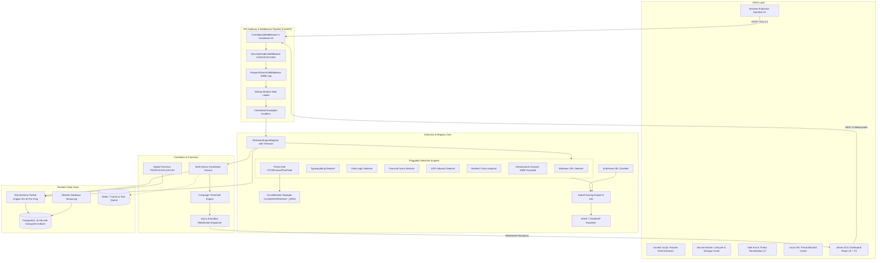
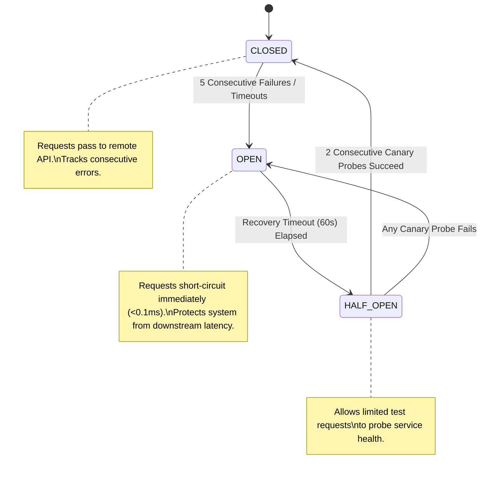

# 🏛️ FraudShield AI — Production Architecture Specification

This document details the modular system architecture, service boundaries, fault-isolation patterns, data flows, and design principles governing **FraudShield AI**.

---

## 1. System Overview & Modular Monolith Design

FraudShield AI operates as a **production-ready modular monolith** designed with clean domain boundaries, dependency injection, and interface segregation. This architectural pattern eliminates unnecessary microservice network hops while enabling independent testing, isolated fault domains, and effortless future extraction of individual services into independent containers if workload demands require it.



---

## 2. Pluggable Detection Engine Registry

All threat detectors implement the standard `BaseDetectionEngine` abstract interface, decoupling detection algorithms from request processing and persistence.

```python
class BaseDetectionEngine(ABC):
    @property
    @abstractmethod
    def name(self) -> str:
        """Unique engine identifier."""
        pass

    @abstractmethod
    async def analyze(self, context: ScanContext) -> EngineResult:
        """Executes detection returning standardized findings."""
        pass
```

### Registry Lifecycle & Fault Isolation
1. **Dynamic Engine Discovery**: Engines register with `DetectionEngineRegistry.register(engine)`.
2. **Per-Engine Execution Timeout**: When executing scans, the registry wraps each engine call in `asyncio.wait_for(engine.analyze(context), timeout=3.0)`.
3. **Zero-Crash Fault Isolation**: If an engine crashes with an unhandled exception or times out, the registry safely intercepts the failure, logs a structured error with correlation tracking, and produces a fallback result (`is_suspicious=False, score=0`). Other engines proceed uninterrupted.
4. **Extensibility**: Adding a new threat engine requires only inheriting from `BaseDetectionEngine` and registering it—zero alterations to route handlers or database schemas are needed.

---

## 3. Circuit Breaker Architecture

External threat intelligence integrations (`VirusTotal`, `URLhaus`, `PhishTank`) are decoupled through independent circuit breakers implemented in `app.core.circuit_breaker.CircuitBreaker`.



### Circuit Breaker Specifications:
- **Failure Threshold**: 5 consecutive errors or timeouts trigger state change `CLOSED -> OPEN`.
- **Recovery Timeout**: 60.0 seconds cooldown before testing recovery.
- **Canary Probe Success Threshold**: 2 consecutive healthy responses trigger `HALF_OPEN -> CLOSED`.
- **Health Telemetry**: Active circuit status is exposed in `/health/ready` and admin diagnostics.

---

## 4. Scalable Multi-Device Event Correlation

To prevent denial-of-service and out-of-memory crashes when processing millions of telemetry events:
- **Zero In-Memory Event Iteration**: The legacy pattern of loading all raw historical events into application memory (`.all()`) has been completely replaced with atomic database-side SQL aggregations (`func.count(DetectionEvent.id)` and `func.count(func.distinct(DetectionEvent.device_id))`).
- **Sliding-Window Time Filtering**: Aggregations evaluate events within `last_seen >= now - timedelta(seconds=settings.CAMPAIGN_WINDOW_SECONDS)`.
- **Concurrent Race-Safe Ingestion**: Database insertions for `URLRecord`, `Device`, and `InfrastructureRecord` catch `IntegrityError` on `db.flush()`, automatically roll back sub-transactions, and re-query existing records, preventing race-condition failures during concurrent scan bursts.

---

## 5. Security & Middleware Pipeline

All ingress traffic passes through a unified ASGI middleware chain:

1. **`CorrelationIdMiddleware`**:
   - Inspects `X-Correlation-ID` header; generates a cryptographically secure UUIDv4 if omitted.
   - Attaches `correlation_id` to `contextvars` for structured JSON log traces.
   - Measures response duration and appends `X-Response-Time-MS` and `X-Correlation-ID` to all HTTP responses.
2. **`RequestSizeLimitMiddleware`**:
   - Enforces an absolute 30MB payload boundary to protect the ASGI server from buffer exhaustion and decompression bombs.
3. **`SecurityHeadersMiddleware`**:
   - Appends enterprise-grade defenses: `X-Content-Type-Options: nosniff`, `X-Frame-Options: DENY`, `Strict-Transport-Security: max-age=31536000; includeSubDomains`, and `Content-Security-Policy: default-src 'self'`.
4. **Centralized Exception Handler**:
   - Catches `HTTPException`, `RequestValidationError`, `SQLAlchemyError`, and uncaught exceptions.
   - Sanitizes production responses to guarantee internal stack traces and server file paths are never leaked to external clients.

---

## 6. Digital Forensics Zero-Execution Sandbox

The file analysis subsystem operates in complete execution isolation:
- **Static Parsing Only**: Files are analyzed using memory-mapped pure parsers (`pypdf`, `python-docx`, `openpyxl`). No binary execution or shell invocations ever occur.
- **XXE Injection Neutralization**: OpenXML containers (`.docx`, `.xlsx`) inspect internal `.xml` and `.rels` streams before expansion, strictly aborting on `<!ENTITY`, `<!DOCTYPE`, or SYSTEM entity declarations.
- **Formula Injection Defense**: CSV cells starting with formula triggers (`=`, `+`, `-`, `@`, `\t`, `\r`) are neutralized with leading apostrophe escapes.
- **Resource Limits**: Strict 25MB file size caps, 500-page limits for PDFs, and 100,000-row limits for spreadsheets prevent memory exhaustion.
