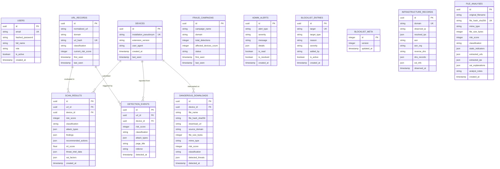

# 🗄️ FraudShield AI — Database Architecture & Schema Specification

This document provides the complete database design, Entity-Relationship (ER) model, indexing strategy, Alembic migration workflow, and query optimization guidelines for **FraudShield AI**.

---

## 1. Entity-Relationship Diagram (ERD)



---

## 2. Table Specifications & Indexing Strategy

To support high-throughput scans, low-latency search, and time-series aggregations, indexes are placed on equality lookups, foreign keys, and sorting fields:

### A. `detection_events`
- `ix_detection_events_detected_at` (`detected_at` DESC): Accelerates dashboard time-series queries.
- `ix_detection_events_risk_score` (`risk_score`): Filters high-severity events.
- `ix_detection_events_classification` (`classification`): Accelerates categorical queries (`CRITICAL`, `CAUTION`, `SAFE`).
- `ix_detection_events_url_detected` (`url_id`, `detected_at`): Composite index for domain-level event aggregation.
- `ix_detection_events_device_detected` (`device_id`, `detected_at`): Composite index for unique device correlation.

### B. `scan_results`
- `ix_scan_results_created_at` (`created_at` DESC): Accelerates recent scan feeds.
- `ix_scan_results_risk_score` (`risk_score`): Fast threshold filtering.
- `ix_scan_results_classification` (`classification`): Fast classification filtering.
- `ix_scan_results_url_created` (`url_id`, `created_at`): Composite index for URL scan history.

### C. `fraud_campaigns`
- `ix_fraud_campaigns_status` (`status`): Fast lookup for `ACTIVE` campaigns.
- `ix_fraud_campaigns_first_seen` / `ix_fraud_campaigns_last_seen`: Time-range queries for SOC reports.

### D. `admin_alerts`
- `ix_admin_alerts_alert_type` / `ix_admin_alerts_severity`: Filtering by threat category and impact.
- `ix_admin_alerts_is_read` / `ix_admin_alerts_is_resolved`: Fast unread queue indexing.
- `ix_admin_alerts_created_at` (`created_at` DESC): Timeline ordering.

### E. `blocklist_entries`
- `ix_blocklist_entries_is_active` (`is_active`): Accelerates client blocklist synchronization (`/api/blocklist/version`).

### F. `infrastructure_records`
- `ix_infrastructure_records_observed_at`: Timeline tracking of IP and ASN migration.
- `ix_infrastructure_records_observed_ip`: Correlation across multiple phishing domains sharing the same hosting IP.

---

## 3. Query Optimization Guidelines

### 1. Eliminating N+1 Query Patterns
Never query child relationships inside an iteration loop. Use SQLAlchemy `joinedload` or batch `IN` queries:
```python
# HIGH PERFORMANCE: Single SQL query with JOIN
events = db.query(DetectionEvent)\
    .options(joinedload(DetectionEvent.device))\
    .options(joinedload(DetectionEvent.url_record))\
    .order_by(DetectionEvent.detected_at.desc())\
    .offset(skip).limit(limit).all()
```

### 2. Paginating All Record Collections
Every collection endpoint MUST enforce `limit` and `skip` query parameters:
```python
@router.get("", response_model=List[ThreatOut])
def list_threats(
    limit: int = Query(50, ge=1, le=500),
    skip: int = Query(0, ge=0),
    db: Session = Depends(get_db)
):
    return db.query(ScanResult).offset(skip).limit(limit).all()
```

### 3. Database-Side Aggregations
Avoid loading records into Python memory to compute metrics. Let the database engine execute aggregations:
```python
# Database-Side Count and Distinct Aggregation
total_count = db.query(func.count(DetectionEvent.id)).filter(...).scalar()
unique_devices = db.query(func.count(func.distinct(DetectionEvent.device_id))).filter(...).scalar()
```

---

## 4. Alembic Database Migration Management

The repository uses Alembic for declarative schema versioning:

### Initializing and Applying Migrations:
```bash
# Apply pending migrations to database head
cd backend
venv\Scripts\alembic upgrade head

# Generate a new auto-detected migration
venv\Scripts\alembic revision --autogenerate -m "Add composite index on detection events"

# Inspect migration history
venv\Scripts\alembic history --verbose

# Roll back by one migration revision
venv\Scripts\alembic downgrade -1
```

### Migration Integrity Rules:
- All schema alterations MUST be executed through Alembic revisions; never alter production database tables manually via raw SQL.
- Migration scripts must include both `upgrade()` and clean `downgrade()` methods.
- Column additions must provide nullable defaults or server defaults to prevent locking large tables.

