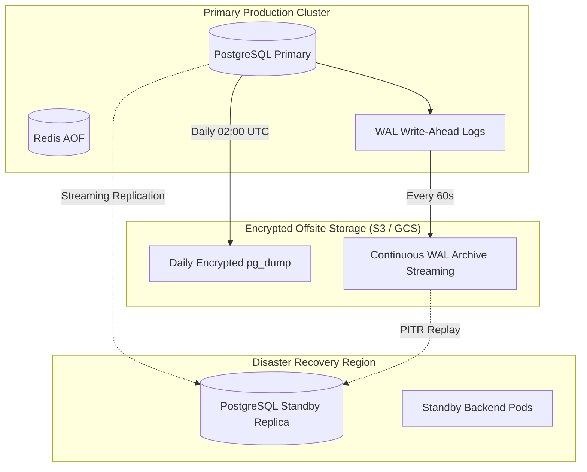

# 🚨 FraudShield AI — Business Continuity & Disaster Recovery (BC/DR) Plan

This document establishes the Recovery Point Objectives (RPO), Recovery Time Objectives (RTO), backup automation, database failover procedures, and incident recovery runbooks for **FraudShield AI**.

---

## 1. Recovery Objectives (RPO & RTO)

| Service Tier | Criticality | Target RPO (Data Loss Tolerance) | Target RTO (Downtime Tolerance) |
| :--- | :--- | :--- | :--- |
| **Real-Time URL Scanning** | Critical (Tier 1) | 0 minutes (Stateless) | $< 2\text{ minutes}$ |
| **Global Threat Blocklist** | High (Tier 1) | $< 1\text{ hour}$ | $< 5\text{ minutes}$ |
| **Multi-Device Campaign Events** | High (Tier 2) | $< 15\text{ minutes}$ | $< 15\text{ minutes}$ |
| **Forensic Dossiers & Reports** | Medium (Tier 3) | $< 24\text{ hours}$ | $< 1\text{ hour}$ |

---

## 2. Backup Architecture & Data Protection



### 1. PostgreSQL Database Backups
- **Continuous WAL Archiving**: Write-Ahead Logs (WAL) are streamed to encrypted object storage every 60 seconds, enabling Point-In-Time Recovery (PITR) down to any specific second within the last 30 days.
- **Daily Full Logical Snapshot**: Executed via `pg_dump` every night at 02:00 UTC, AES-256 encrypted, and replicated across multi-region object storage.

### 2. Redis State Persistence
- Redis is configured with Append-Only File (`AOF`) logging: `appendonly yes`, `appendfsync everysec`.
- In the event of a sudden container termination, Redis reconstructs state from disk with zero data loss.

---

## 3. Disaster Recovery Runbooks

### Runbook 1: Primary Database Catastrophic Failure / Corruption
1. **Declare Outage & Halt Writes**:
   ```bash
   kubectl scale deployment fraudshield-backend --replicas=0
   ```
2. **Restore Latest Full Snapshot**:
   ```bash
   gunzip -c /backups/fraudshield_db_latest.sql.gz | psql -U fraudshield_user -d fraudshield_db
   ```
3. **Execute Point-In-Time Rollforward**:
   Apply WAL segments from the continuous archive up to the designated recovery target time.
4. **Run Alembic Schema Verification**:
   ```bash
   alembic upgrade head
   ```
5. **Resume Workload**:
   ```bash
   kubectl scale deployment fraudshield-backend --replicas=3
   ```

---

### Runbook 2: Compromised JWT `SECRET_KEY` Incident
If the administrative JWT signing secret is exposed or suspected of compromise:
1. **Rotate Secret Key in Secrets Manager**:
   Generate a new 64-character cryptographic token:
   ```bash
   openssl rand -hex 32
   ```
2. **Update Environment / Kubernetes Secret**:
   Update `SECRET_KEY` in deployment configuration.
3. **Rolling Restart of Backend Pods**:
   ```bash
   kubectl rollout restart deployment/fraudshield-backend
   ```
4. **Invalidate Active Sessions**:
   Because JWT tokens are signed with `SECRET_KEY`, rotating the secret instantly invalidates 100% of outstanding access tokens across all devices and SOC users, forcing clean re-authentication.

---

### Runbook 3: Complete Datacenter / Cloud Region Outage
1. **Reroute DNS Traffic**: Update Cloudflare / Route53 DNS CNAME records to point to the Disaster Recovery (DR) region ingress gateway.
2. **Promote Standby PostgreSQL Replica to Master**:
   ```bash
   pg_ctl promote -D /var/lib/postgresql/data
   ```
3. **Scale DR Backend Pods**: Scale backend instances from standby pool (1 replica) to production capacity (10+ replicas).
4. **Verify Health**: Probe `GET https://dr-api.fraudshield.ai/health/ready` to verify complete system operational status.

---

## 4. Disaster Recovery Drill Schedule

To guarantee recovery readiness:
- **Bi-Annual Failover Drill**: Every 6 months, production traffic is gracefully shifted to the secondary DR region for 4 hours during scheduled maintenance.
- **Quarterly Snapshot Restoration Test**: Every 3 months, automated CI pipelines restore the latest production snapshot into an isolated sandbox environment and run the full 77-test suite to verify backup integrity.

