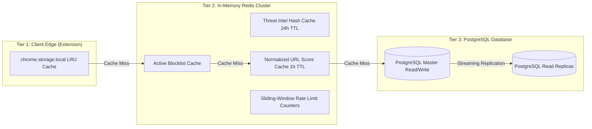

# 📈 FraudShield AI — Platform Scalability & Capacity Plan

This document outlines the architectural roadmap, caching tiers, database sharding strategies, and capacity models required to scale **FraudShield AI** from single-instance deployments to over 100,000+ active browser extensions and enterprise SOC workloads.

---

## 1. Workload Modeling & Capacity Forecast

| Metric | Phase 1 (Initial Deploy) | Phase 2 (Growth) | Phase 3 (Enterprise Scale) |
| :--- | :--- | :--- | :--- |
| **Active Browser Extensions** | 1,000 – 5,000 | 25,000 – 50,000 | 100,000+ |
| **Peak Scans / Second** | 20 – 50 RPS | 250 – 500 RPS | 1,500 – 3,000 RPS |
| **Daily Detection Events** | 5,000 | 100,000 | 1,000,000+ |
| **Concurrent SOC Analysts** | 2 – 5 | 15 – 30 | 100+ |
| **Storage Growth / Month** | ~5 GB | ~50 GB | ~300 GB |

---

## 2. Multi-Tier Caching Architecture

To support 1,500+ requests per second without saturating the relational database, FraudShield AI utilizes a three-tier caching hierarchy:



### 1. Client-Side Edge Caching (Tier 1)
- The browser extension caches verified high-frequency domains (e.g., top 10,000 legitimate sites) locally in `chrome.storage.local`.
- Local blocklist lookups run in sub-millisecond time (`< 0.5ms`) without network calls.
- Cache entries have a configurable TTL (default 12 hours) with invalidation via incremental version sync (`/api/blocklist/version`).

### 2. Distributed Redis Cache (Tier 2)
- **Threat Intelligence Hash Cache**: Results from external providers (VirusTotal, URLhaus) are keyed by SHA-256 with a 24-hour TTL, slashing external API credit usage by up to 92%.
- **URL Score Cache**: Verified benign URL scans are cached for 1 hour.
- **Sliding-Window Rate Limiting**: Redis sorted sets (`ZSET`) maintain sliding-window rate limit counters across horizontally scaled backend pods.

### 3. Read Replicas & Connection Pooling (Tier 3)
- Database read operations (`/api/threats`, `/api/events`, `/api/campaigns`, `/api/metrics`) route to read replicas through HAProxy / PgBouncer.
- Master node is reserved strictly for writes (`/api/scan/url`, `/api/events/detection`, `/api/downloads/analyze`).

---

## 3. Database Scalability & Connection Management

### SQLAlchemy Connection Pooling
Production database configurations are optimized for high concurrency:
- **`pool_size = 20`**: Base dedicated persistent connection pool per backend worker.
- **`max_overflow = 10`**: Burst buffer for unexpected traffic spikes.
- **`pool_timeout = 30`**: Strict connection acquisition timeout to prevent thread starvation.
- **`pool_recycle = 1800`**: Recycles idle connections after 30 minutes to prevent stale TCP drops by firewalls.
- **`pool_pre_ping = True`**: Health-checks socket liveness before issuing queries, eliminating disconnected socket errors.

### PgBouncer Connection Pooling
For deployments exceeding 5 backend nodes, PgBouncer is deployed in **transaction pooling mode**:
- Maps thousands of client connections to a pool of 50–100 PostgreSQL backend connections.
- Reduces PostgreSQL RAM footprint from ~10MB per backend thread to a lean shared pool.

### Partitioning & Cold-Storage Data Lifecycle
1. **Range Partitioning**: The `detection_events` table is partitioned by month on `detected_at`.
2. **Archival Job**: A scheduled Celery task detaches partitions older than 90 days, compresses them into Parquet format, and stores them in encrypted object storage (S3/GCS) for long-term compliance and forensic replay.

---

## 4. Horizontal Backend Autoscaling (Kubernetes / HPA)

Backend pods are stateless and scale horizontally based on CPU and request latency metrics:

```yaml
apiVersion: autoscaling/v2
kind: HorizontalPodAutoscaler
metadata:
  name: fraudshield-backend-hpa
spec:
  scaleTargetRef:
    apiVersion: apps/v1
    kind: Deployment
    name: fraudshield-backend
  minReplicas: 3
  maxReplicas: 25
  metrics:
  - type: Resource
    resource:
      name: cpu
      target:
        type: Utilization
        averageUtilization: 70
  - type: Resource
    resource:
      name: memory
      target:
        type: Utilization
        averageUtilization: 80
```

---

## 5. Background Task Queues (Celery & Redis)

Long-running operations are offloaded from HTTP request lifecycles to asynchronous worker queues:
- **Digital Forensic File Processing**: Uploaded documents (`.pdf`, `.docx`, `.xlsx`) are stored in temporary staging and handed to Celery workers via task IDs, keeping HTTP endpoints fast and responsive (`< 50ms`).
- **Campaign Retrospective Scans**: Re-evaluating historical events against newly added blocklist indicators runs asynchronously in batch queues.
- **Threat Intelligence Pre-Fetching**: Top unclassified domains are pre-analyzed in background queues during low-traffic periods.

